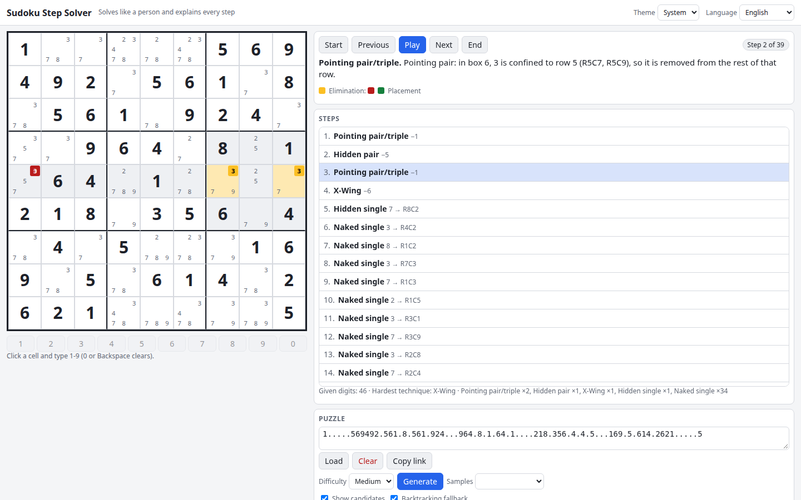

# Sudoku Step Solver

Paste or generate a Sudoku and watch it being solved the way a person would: every step names its technique, highlights the pattern and shows which candidates it removes. When no human technique is left, a backtracking fallback finishes the job.

**Try it: [hermes98761234.github.io/sudoku-step-solver](https://hermes98761234.github.io/sudoku-step-solver/)**

[](https://github.com/hermes98761234/sudoku-step-solver/actions/workflows/deploy.yml)



## Features

- **Explained steps.** Naked and hidden singles, pointing pairs and triples, box/line reduction, naked and hidden pairs and triples, X-Wing, Swordfish and Jellyfish.
- **Highlights.** The pattern cells, the placed digit and the eliminated candidates are marked on the board for the selected step.
- **Step list and playback.** Jump to any step, step back and forth or autoplay. You can switch individual techniques off.
- **Backtracking fallback** for puzzles that need guessing, flagged as such. Invalid and multi-solution puzzles are detected.
- **Puzzle generator** with four difficulty levels, always with a unique solution.
- **Share by URL**, 81-character import/export, candidate display toggle.
- English and Ukrainian, light, dark or system theme. Settings are remembered in the browser; nothing leaves it.

## How it works

The board keeps a 9-bit candidate mask per cell. Each technique is a pure function that scans the 27 units (rows, columns, boxes) and returns the first step that places a digit or removes candidates; steps are applied one at a time. Fish patterns (X-Wing and up) are found by choosing n base lines whose candidate positions for a digit fit in exactly n cover lines. A bitmask backtracking solver (most-constrained cell first) counts solutions, verifies uniqueness and supplies the fallback guess. The generator fills a random grid, then removes digits in symmetric pairs while the solution stays unique and the human techniques allowed for the chosen difficulty still solve it.

## Quick start

You need [Node.js](https://nodejs.org/) 22.

```bash
git clone https://github.com/hermes98761234/sudoku-step-solver.git
cd sudoku-step-solver
npm install
npm run dev       # http://localhost:5173
npm test          # unit tests
npm run build     # static site in dist/
```

## License

MIT
